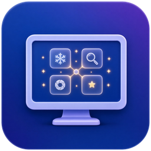
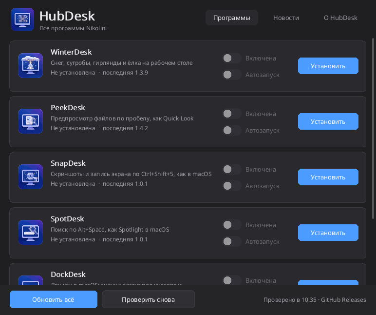
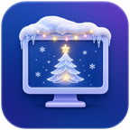
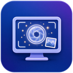
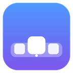
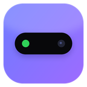
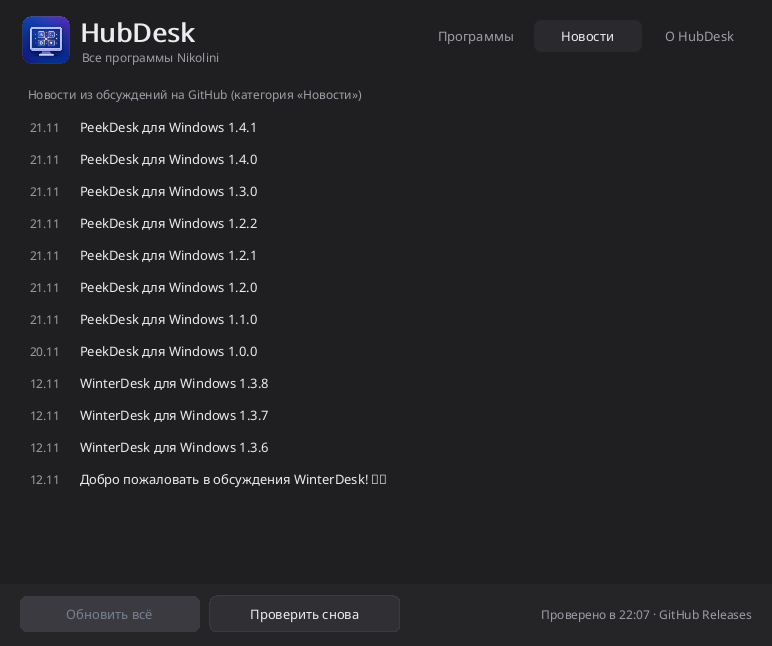
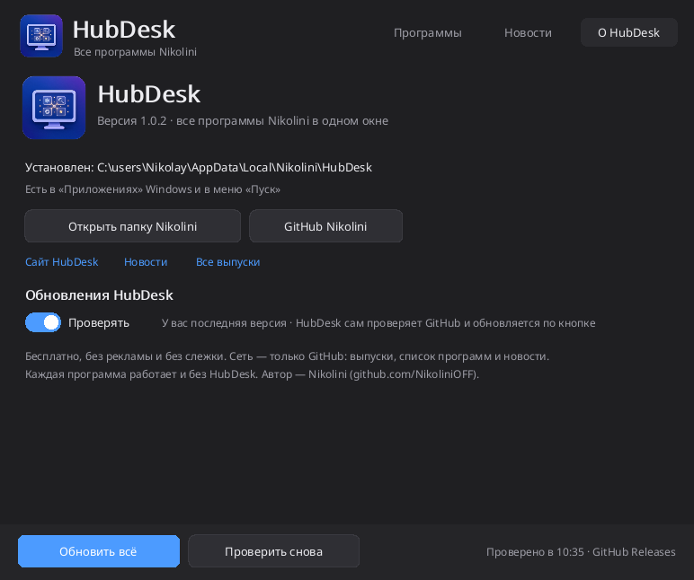

  

<h1 align="center">HubDesk для Windows</h1>

  <b>Все программы Nikolini в одном окне: установить, включить, обновить — галочками.</b> 
  WinterDesk, PeekDesk, SnapDesk, DockDesk, SpotDesk, IslandDesk и новые программы — без поиска архивов и ручной распаковки. 
  Бесплатно · без рекламы · без слежки · каждая программа работает и без HubDesk.

  
   Скачивается сразу ZIP с последней версией · <a href="https://github.com/NikoliniOFF/HubDesk/releases">Все версии</a> · <a href="https://nikolinioff.github.io/HubDesk/">Сайт</a>

  
  
  

---

## ✨ Что умеет

| | |
|---|---|
| 📦 **Установка в один щелчок** | Выберите программу — HubDesk скачает её с GitHub, проверит контрольную сумму SHA-256 и поставит в `%LOCALAPPDATA%\Nikolini\<программа>`. Права администратора не нужны. |
| 🔘 **Включить и автозапуск** | У каждой программы два переключателя: «Включена» (запустить или аккуратно закрыть) и «Автозапуск» (запускать вместе с Windows). |
| 🔄 **Обновления** | HubDesk показывает установленную и последнюю версию. «Обновить» — одну программу, «Обновить всё» — сразу все; настройки программ сохраняются. |
| 🗑️ **Удаление как у всех** | Программы Nikolini видны в «Параметры → Приложения» и удаляются оттуда начисто: папка, автозапуск, записи в реестре. Настройки по желанию остаются. |
| 📂 **Уже установленные** | Если вы раньше распаковали программу Nikolini вручную, HubDesk найдёт их и будет управлять ими на месте. Перенести в папку Nikolini — только по кнопке, ничего не двигается молча. |
| 🚀 **Новые программы** | Список программ HubDesk берёт с GitHub: когда выходит новая программа Nikolini, она сама появляется в окне — обновлять HubDesk не нужно. |
| 📰 **Новости** | Свежие выпуски и объявления из обсуждений на GitHub — на отдельной вкладке. |
| 🪶 **Лёгкий** | Один файл, меньше мегабайта. В простое HubDesk ничего не делает и ничего не опрашивает; в сеть — только при запуске и по кнопке «Проверить снова». |

## 🧩 Программы

| | Программа | Что делает |
|---|---|---|
|  | **[WinterDesk](https://nikolinioff.github.io/WinterDesk/)** | Снег на рабочем столе: сугробы на окнах, гирлянды, ёлочка и отсчёт до Нового года |
|  | **[PeekDesk](https://nikolinioff.github.io/PeekDesk/)** | Предпросмотр файлов по пробелу в Проводнике, как Quick Look в macOS |
|  | **[SnapDesk](https://nikolinioff.github.io/SnapDesk/)** | Скриншоты и запись экрана по <kbd>Ctrl</kbd>+<kbd>Shift</kbd>+<kbd>5</kbd>, как в macOS |
|  | **[DockDesk](https://nikolinioff.github.io/DockDesk/)** | Док внизу экрана, как в macOS: любимые программы под рукой, значки растут под курсором |
|  | **[SpotDesk](https://nikolinioff.github.io/SpotDesk/)** | Поиск по <kbd>Alt</kbd>+<kbd>Space</kbd>, как Spotlight в macOS: программы, файлы, калькулятор и курсы валют |
|  | **[IslandDesk](https://nikolinioff.github.io/IslandDesk/)** | «Динамический остров» для Windows: музыка, громкость, таймер, загрузки и уведомления в живой пилюле вверху экрана |

> **HubDesk — надстройка, а не обязательная часть.** Каждую программу можно скачать и запустить отдельно, без HubDesk, а сам HubDesk можно удалить в любой момент — программы продолжат работать.

## 📸 Как это выглядит

 

## 📥 Как установить

1. Скачайте **[HubDesk-win64.zip](https://github.com/NikoliniOFF/HubDesk/releases/latest/download/HubDesk-win64.zip)** (или выберите файл на странице [последней версии](https://github.com/NikoliniOFF/HubDesk/releases/latest)).
2. Распакуйте архив и запустите **HubDesk.exe**.
3. Нажмите **«Установить»** в синей полосе сверху — HubDesk скопирует себя в `%LOCALAPPDATA%\Nikolini\HubDesk`, появится в меню «Пуск» и в «Приложениях». Можно и не устанавливать — HubDesk работает из любой папки.
4. Включите нужные программы переключателем «Включена».
5. Если Windows покажет синее окно *«Система Windows защитила ваш компьютер»*, нажмите **«Подробнее» → «Выполнить в любом случае»** (подробнее — в разделе «Вопросы»).

## ❓ Вопросы

<b>Windows пишет «Система Windows защитила ваш компьютер»</b>

Это фильтр SmartScreen: программа новая и пока не подписана платным сертификатом. Нажмите **«Подробнее»**, затем **«Выполнить в любом случае»**. Скачивайте HubDesk только со [страницы выпусков](https://github.com/NikoliniOFF/HubDesk/releases) — рядом с каждым архивом лежит файл `.sha256` с контрольной суммой.

<b>Нужен ли HubDesk, чтобы пользоваться WinterDesk или PeekDesk?</b>

Нет. Каждая программа Nikolini полностью самостоятельна: у неё свои настройки, автозапуск и обновления. HubDesk просто собирает их в одном окне, чтобы было удобнее ставить, включать и обновлять.

<b>Как удалить программу или сам HubDesk?</b>

В «Параметры → Приложения» (или «Программы и компоненты») найдите программу Nikolini и нажмите «Удалить». Программа аккуратно закроется, исчезнут её папка, автозапуск и записи в реестре; настройки из `%APPDATA%` по умолчанию остаются — HubDesk спросит. Удалить можно и из самого HubDesk (ссылка «Удалить» в карточке) или командой `HubDesk.exe --uninstall <Программа>`. Если удалить HubDesk раньше других программ, его маленькая служебная копия останется в `%LOCALAPPDATA%\Nikolini\HubDesk`, чтобы оставшиеся программы тоже удалялись начисто; уйдёт вместе с последней.

<b>Программа что-нибудь отправляет?</b>

Нет. HubDesk обращается только к GitHub: список программ (`apps.json` в этом репозитории), выпуски и новости. Никаких счётчиков, аналитики и рекламы.

<b>Не будет ли тормозить компьютер?</b>

Нет. HubDesk не висит в фоне без дела: открыли окно — посмотрели — закрыли. В открытом окне в простое он не тратит процессор и ничего не опрашивает.

## 🧩 Другие программы от Nikolini

<table>
  <tr>
    <td width="96" align="center"></td>
    <td>
      <b><a href="https://nikolinioff.github.io/WinterDesk/">WinterDesk</a></b> — снег на рабочем столе Windows: сугробы на окнах, гирлянды, ёлочка и отсчёт до Нового года. 
      <a href="https://nikolinioff.github.io/WinterDesk/">Сайт</a> · <a href="https://github.com/NikoliniOFF/WinterDesk">GitHub</a>
    </td>
  </tr>
  <tr>
    <td width="96" align="center"></td>
    <td>
      <b><a href="https://nikolinioff.github.io/PeekDesk/">PeekDesk</a></b> — предпросмотр файлов по пробелу в Проводнике Windows, как Quick Look в macOS. 
      <a href="https://nikolinioff.github.io/PeekDesk/">Сайт</a> · <a href="https://github.com/NikoliniOFF/PeekDesk">GitHub</a>
    </td>
  </tr>
  <tr>
    <td width="96" align="center"></td>
    <td>
      <b><a href="https://nikolinioff.github.io/SnapDesk/">SnapDesk</a></b> — скриншоты и запись экрана по горячей клавише в Windows, как Cmd+Shift+5 в macOS: область, окно, экран или видео. 
      <a href="https://nikolinioff.github.io/SnapDesk/">Сайт</a> · <a href="https://github.com/NikoliniOFF/SnapDesk">GitHub</a>
    </td>
  </tr>
  <tr>
    <td width="96" align="center"></td>
    <td>
      <b><a href="https://nikolinioff.github.io/DockDesk/">DockDesk</a></b> — док для Windows, как в macOS: любимые программы внизу экрана, значки плавно растут под курсором. 
      <a href="https://nikolinioff.github.io/DockDesk/">Сайт</a> · <a href="https://github.com/NikoliniOFF/DockDesk">GitHub</a>
    </td>
  </tr>
  <tr>
    <td width="96" align="center"></td>
    <td>
      <b><a href="https://nikolinioff.github.io/SpotDesk/">SpotDesk</a></b> — быстрый поиск по Alt+Space в Windows, как Spotlight в macOS: программы, файлы, калькулятор и курсы валют. 
      <a href="https://nikolinioff.github.io/SpotDesk/">Сайт</a> · <a href="https://github.com/NikoliniOFF/SpotDesk">GitHub</a>
    </td>
  </tr>
  <tr>
    <td width="96" align="center"></td>
    <td>
      <b><a href="https://nikolinioff.github.io/IslandDesk/">IslandDesk</a></b> — «динамический остров» для Windows: музыка, громкость, таймер, загрузки и уведомления в живой пилюле вверху экрана. 
      <a href="https://nikolinioff.github.io/IslandDesk/">Сайт</a> · <a href="https://github.com/NikoliniOFF/IslandDesk">GitHub</a>
    </td>
  </tr>
  <!-- Новая программа: скопируйте строку <tr>…</tr> выше и поменяйте значок, название, описание и ссылки. -->
</table>

Все программы — на [github.com/NikoliniOFF](https://github.com/NikoliniOFF).

## 💬 Обсуждение

- 📰 [Новости](https://github.com/NikoliniOFF/HubDesk/discussions/categories/%D0%BD%D0%BE%D0%B2%D0%BE%D1%81%D1%82%D0%B8)
- 💡 [Предложить идею](https://github.com/NikoliniOFF/HubDesk/discussions/new?category=%D0%B8%D0%B4%D0%B5%D0%B8)
- 🐞 [Сообщить о баге](https://github.com/NikoliniOFF/HubDesk/issues/new)
- 💬 [Все обсуждения](https://github.com/NikoliniOFF/HubDesk/discussions)

---

HubDesk · автор — <a href="https://github.com/NikoliniOFF">Nikolini (NikoliniOFF)</a> · бесплатно и без рекламы

